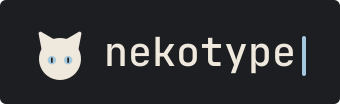

<p align="center">
  
</p>

# Nekotype (ねこタイプ)

> A lightweight, keyboard-first web app for learning Hiragana and Katakana from zero, with adaptive unlocking, spaced reviews and progress tracking, instantaneous feedback, dual-tier romaji matching and zero latency.

**Status.** The code implements phases P0–P6 of the MVP specified in [docs/spec/](docs/spec/README.md), which is learning-first ([ADR 058](docs/adr/058-learning-first.md), [ADR 093](docs/adr/093-learning-only-words-in-learning.md), [ADR 099](docs/adr/099-learning-home-methods-and-phases-after-p6.md)): `/` teaches hiragana and katakana with introductions, recall, recognition and reviews that a knowledge model plans (FSRS-6, ADR 100), with the answers kept as a log in IndexedDB. Phase P6 removed the typing trainer: its screen, `/type`, answers 404, and its data are gone from the client, the sync and D1: what syncs is the learning log and settings only (sync format 3: the own events go to the server as batches, one D1 row each, and the events of other devices are pulled; IndexedDB schema 6; [ADR 100](docs/adr/100-knowledge-model-fsrs-planner-and-answer-log.md), [ADR 102](docs/adr/102-sync-format-3-server.md)). Since P5 a user can sign in with Google or GitHub on production: progress and settings sync through Pages Functions and D1, the account can be deleted, and `POST /api/reports` takes reports of a wrong reading or translation (Turnstile; the client's report dialog returns with words in P12).

Next come the adaptive knowledge model (P7), the learning home and the progress screen (P8), more learning methods (P9), kana audio (P10), a placement test and mnemonics (P11), then words in learning (P12) and vocabulary (P13).

[](LICENSE)
[](https://www.typescriptlang.org/)
[](https://feature-sliced.design/)
[](#-performance-budgets)

---

## ✨ Features

- **🌱 Learning on `/`:** two tracks (hiragana, katakana); one "Continue" starts a session of 30 tasks (introduction, recall by typing, recognition among 4 options) that a planner chooses from the learner's memory: new kana when fewer than four are being learned and the kana they are built from are learned, learning kana back after 30 s to 8 min, learned kana before their recall falls below 90% (reviews of both tracks); the chart shows locked, learning, learned and mastered kana and a due mark, the progress line `due: n`; a streak and a daily answer-time chart on `/stats`.
- **⚡ Zero-Latency Input:** Driven by an immutable Non-deterministic Finite Automaton (NFA) engine and fine-grained Preact signals. Keystrokes of recall update without component tree re-renders.
- **🎯 Two-Tier Romaji Matching:**
  - **Strict IME Mode:** Strictly enforces official Microsoft IME / Google Japanese Input romaji keystrokes (e.g. `ti` → ち, `thi` → ティ, `who` → ウォ, `wo` → を).
  - **Learner Mode:** Accommodates intuitive learner habits (Hepburn, Kunrei, Nihon-shiki, vowel lengthening like `koohii`, and reading hints like `wa` for particle は in こんにちは).
- **🔤 Comprehensive Kana Coverage:**
  - 31 complete row sets across **Gojūon** (Basic), **Dakuten & Handakuten**, **Yōon** (Digraphs), and **Extended Katakana** (`ext_fa`, `ext_va`, `ext_wi`, `ext_ti`, `ext_che`).
  - Words and phrases (N5–N4, from JMdict, the JLPT lists and Tatoeba) are generated by a pipeline from pinned sources and committed, but the application does not ship them until words join learning.
- **🗃️ Statistics on `/stats`:** the learning progress, all from IndexedDB: the current streak next to the activity map (it fills its width, up to 26 weeks, and dots the days of the streak), the best streak, active days of the last 30, mastered kana, sessions started and finished, and the answer time per day or week.
- **⌨️ Keyboard-First Ergonomics:**
  - Hidden input sink auto-focuses on mount and upon clicking the arena.
  - Typing any letter while a button has focus immediately refocuses and processes the key (Plan 6.2).
  - A recall task shows the kana with a caret and a romaji buffer at it; a wrong key flashes the caret (ADR 041).
  - Hybrid input: `keydown` on a desktop, `beforeinput` and an `input` fallback for mobile keyboards (Gboard composition), so a phone types too (ADR 038).
  - A non-Latin layout is not translated by the physical key: typing a Cyrillic letter shows "switch your keyboard layout to English" and counts no mistake.
  - "turn off the Japanese IME: Nekotype converts romaji itself" appears only when the composition holds kana or kanji; Latin composition does not trigger it.
- **🎨 Design System:** Muted dark palette with a single eye-blue accent, Golos Text / JetBrains Mono / Noto Sans JP, a cat logo and favicon. Tokens live in `apps/web/src/shared/styles/tokens.css` and are checked against [`docs/design/source/tokens.json`](docs/design/source/tokens.json) (ADR 031, ADR 034).
- **🌐 Localization:** Instant bilingual toggle between English and Russian (`en` / `ru`).
- **♿ Accessible:**
  - Native `<dialog>` modal backdrops with automatic focus restoration to opener elements.
  - Polite live regions (`aria-live="polite"`) announcing answers and notices of a session to screen readers.
  - Radio group semantics on segmented selectors.
  - Respects `prefers-reduced-motion` operating system settings.

---

## 🗂️ Repository Layout

A pnpm workspace ([ADR 027](docs/adr/027-pnpm-workspace-layout-for-the-monorepo.md)); packages are consumed as TypeScript source, with no build step.

| Path                | Package             | Contents                                                                                                                                                                                                    |
| ------------------- | ------------------- | ----------------------------------------------------------------------------------------------------------------------------------------------------------------------------------------------------------- |
| `apps/web/`         | `@nekotype/web`     | The Preact single-page app (Feature-Sliced Design), its tests, e2e tests, scripts, assets                                                                                                                   |
| `apps/api/`         | `@nekotype/api`     | The Hono application behind `/api/*` (Pages Functions), its D1 migrations and its tests in the Workers runtime; `functions/` mounts it                                                                      |
| `apps/bench/`       | `@nekotype/bench`   | The CPU and D1 measurement of the real `/api/sync` on a test Pages project (P5); a tool run by hand, never deployed to production                                                                           |
| `packages/engine/`  | `@nekotype/engine`  | The NFA romaji engine and the kana tables; imports nothing, runs in a browser or a Worker                                                                                                                   |
| `packages/shared/`  | `@nekotype/shared`  | Types (`Clock`, `Rng`, `Scheduler`, …), type guards, and the merge, patch and apply functions of the learning state, shared by the client and the API                                                       |
| `packages/model/`   | `@nekotype/model`   | The knowledge model of P7: FSRS-6, the kana items and the grade of each answer (the fold, the planner and the forecast follow); pure, runs in a browser, a Worker and Node                                  |
| `packages/content/` | `@nekotype/content` | The content pipeline (build tool, never bundled): pinned sources, parsers, the word and phrase steps; `generate` writes the content chunks                                                                  |
| `packages/sim/`     | `@nekotype/sim`     | The learner simulation of the P7 research (a tool run by hand, never bundled): a reference learner, the current rule and candidate models; FSRS-6 comes from `@nekotype/model`; `sim` prints the comparison |

Root scripts run the package scripts with `pnpm -r`; run one package directly with `pnpm --filter @nekotype/web run <script>`.

### Content pipeline

Words and phrases are generated, never edited by hand. The input files are pinned in `packages/content/sources.json` and mirrored as assets of a GitHub release ([ADR 068](docs/adr/068-content-sources-mirrored-as-release-assets.md)). `pnpm --filter @nekotype/content run fetch` downloads them into `packages/content/.cache/` and checks the sha256; it needs the system `bzip2`. `pnpm --filter @nekotype/content run generate` builds the chunks into `apps/web/src/entities/prompt/content/` and the reports (`build-report.json`, `ru-coverage.json`, `audit-sample.md`) into the package; it is run by hand, never in CI, and its output is committed. Details are in [packages/content/README.md](packages/content/README.md) and [docs/spec/content.md](docs/spec/content.md).

---

## 🚀 Getting Started

### Prerequisites

- **Node.js**: `v24` or higher
- **pnpm**: `v10` or higher — the exact version is pinned in `packageManager` (`corepack enable` picks it up)

### Installation

```bash
git clone https://github.com/amp-r3/nekotype.git
cd nekotype
pnpm install
```

### Development Server

Start the local development server with Vite:

```bash
pnpm run dev
```

Open your browser to `http://localhost:5173`.

The learning screen needs nothing else. To work on the API (`/api/*`), run a second server next to the first; Vite proxies `/api` to it, so the browser stays on `http://localhost:5173`:

```bash
pnpm run dev:api   # applies the migrations to a local D1, then `wrangler pages dev` on http://localhost:8788
```

Secrets for sign-in and reports go into `.dev.vars` in the repository root, copied from `.dev.vars.example` (git ignores the real file). Signing in locally needs the OAuth clients of [ADR 084](docs/adr/084-oauth-seam-state-cookie-verified-addresses.md): the Google client lists `http://localhost:5173/api/auth/google/callback` as a redirect URI, and GitHub has a separate OAuth App for `http://localhost:5173` (one callback URL per app); production has its own GitHub app, and all four secrets are Pages secrets; reports need `TURNSTILE_SECRET_KEY` in both Pages environments (the production and the preview widget's secret, `--env preview` for the second; [ADR 092](docs/adr/092-report-dialog-turnstile-keys-by-host-and-fail-closed-secret.md)), and locally Cloudflare's test secret from `.dev.vars.example` (`pnpm exec wrangler pages secret put <NAME> --project-name nekotype`). Preview deployments have no sign-in: Google accepts no wildcard redirect URI. With both servers running, open `http://localhost:5173/api/auth/github` (or `/google`); the tests need none of this. `pnpm run db:migrate:local` applies the migrations on their own; the local database is in `.wrangler/` and is safe to delete.

### Automated Verification Suite

Run the full verification pipeline (typecheck, ESLint + Steiger FSD lint, Prettier check, Vitest tests with the engine coverage threshold, production build, size budgets, Playwright e2e):

```bash
pnpm run verify         # what CI runs on a pull request
pnpm run verify:quick   # the same without e2e (what the pre-push hook runs)
```

To run individual verification gates:

```bash
pnpm run typecheck    # tsc --noEmit (zero any, zero as T, zero !)
pnpm run lint         # eslint in every package, plus steiger ./src in apps/web
pnpm run format:check # prettier --check .
pnpm run docs:check   # Markdown links and anchors (docs/README.md, "Conventions")
pnpm test             # vitest run in every package (engine with a coverage threshold)
pnpm run build        # vite production build into apps/web/dist
pnpm run budget       # check-budget.mjs (size budgets from the Vite manifest)
pnpm run e2e          # Playwright on the production bundle (Chromium; WebKit in mobile emulation runs the @mobile tests)
pnpm run e2e:latency  # the keystroke latency test on recall (about 1 min); CI runs it on main, by hand and on pull requests that touch input, the learning session or loading code (ADR 074, 095)
```

Fonts are subset by hand, not in CI: `pnpm --filter @nekotype/web run fonts` downloads the pinned sources into `apps/web/scripts/font-src/` (ignored by git), checks their SHA-256 and rewrites `glyphs.txt` and the `woff2` files in `apps/web/src/assets/fonts/` (ADR 034).

### End-to-End Testing (Playwright)

End-to-end browser integration tests are powered by Playwright and run as the last step of `pnpm run verify` in CI. CI runs in the `mcr.microsoft.com/playwright` image, so it installs no browser (ADR 054); the install below is for your own machine. The pre-push hook does not run them (`verify:quick`); run `pnpm run e2e` yourself when a change touches browser behaviour. The keystroke latency test is separate (`pnpm run e2e:latency`) and runs in CI on `main`, by hand and on pull requests that change a file which can move keystroke latency (ADR 052, 074). Its budgets are measured at 4× CPU throttling of the machine it runs on, so a run on a slower or busy developer machine can fail the worst-keystroke ceilings while CI passes with room to spare; the CI run is the gate (`docs/spec/quality.md`). They need Chromium and WebKit once; WebKit also needs its system libraries (`--with-deps`, which asks for `sudo` on Linux). Without them set `E2E_SKIP_WEBKIT=1` to run Chromium only (CI always runs both).

To install the browser binary and run the E2E suite:

```bash
pnpm --filter @nekotype/web exec playwright install --with-deps chromium webkit    # One-time install of the browsers
pnpm run e2e                        # Run the Playwright suites against the production bundle (vite build + vite preview), then the sync suite
pnpm run e2e:sync                   # Only the sync suite (e2e/sync/): `wrangler pages dev` with the real API, a local D1 and a fake OAuth provider on port 5274 (ADR 091)
(cd apps/web && pnpm exec playwright test -c playwright.sync.config.ts guest-sign-in)   # One sync file
```

### Git Hooks

`pnpm install --frozen-lockfile` runs the `prepare` script, which points Git at the versioned hooks in `.githooks/`. No extra dependencies are involved.

| Hook         | Runs                                                                                                               | Notes                                                                                                                                                                                                                                                                                    |
| ------------ | ------------------------------------------------------------------------------------------------------------------ | ---------------------------------------------------------------------------------------------------------------------------------------------------------------------------------------------------------------------------------------------------------------------------------------- |
| `pre-commit` | Line limit for `AGENTS.md`/`CLAUDE.md` (100), `prettier --check` on staged files, then `typecheck`, `lint`, `test` | Code checks are skipped when only Markdown files are staged                                                                                                                                                                                                                              |
| `pre-push`   | `pnpm run verify:quick` (no e2e); `prettier --check` and `docs:check` only if the push changes only `.md` files    | The e2e are not part of it: `pnpm run e2e` runs them against their own production build served on port 5273 (`E2E_PORT`), never a dev server you keep running; they need `pnpm --filter @nekotype/web exec playwright install --with-deps chromium webkit` once (or `E2E_SKIP_WEBKIT=1`) |

CI runs `verify` (with e2e) on every pull request, and on `main` unless the tree already passed in its pull request (ADR 097); the hooks catch the same failures, except the browser ones, earlier. In an emergency, `git commit --no-verify` / `git push --no-verify` skips them.

---

## 📦 Performance Budgets

Nekotype adheres to strict first-load asset caps, checked by `pnpm run budget` (part of `verify`) from the Vite manifest. Figures of the current build:

| Asset                      | Budget Limit | Actual (gzip / woff2)  | Status                    |
| -------------------------- | ------------ | ---------------------- | ------------------------- |
| **Initial HTML**           | $\le 5$ KB   | **0.42 KB**            | ✅ Passed                 |
| **Initial JavaScript**     | $\le 35$ KB  | **31.06 KB**           | ✅ Passed                 |
| **Initial CSS**            | $\le 10$ KB  | **7.64 KB**            | ✅ Passed                 |
| **Noto Sans JP 400**       | $\le 45$ KB  | **20.38 KB** (woff2)   | ✅ Passed                 |
| **JetBrains Mono 400/500** | $\le 45$ KB  | **10.79 / 10.61 KB**   | ✅ Passed                 |
| **Golos Text 400/500**     | $\le 45$ KB  | **9.42 / 9.56 KB**     | ✅ Passed                 |
| **Total First Load**       | $\le 160$ KB | **99.88 KB**           | ✅ Passed (62% of budget) |
| **Lazy content chunk**     | $\le 40$ KB  | none shipped (P12)     | —                         |
| **Lazy route chunk**       | $\le 25$ KB  | **10.09 KB** (largest) | ✅ Passed                 |

---

## ☁️ Deployment

Nekotype is a static SPA (`apps/web/dist/`; settings and learning progress in IndexedDB, the language in `localStorage`) with an API behind `/api/*`: Pages Functions (`functions/api/[[route]].ts` mounts the Hono app of `apps/api`) and a D1 database. It ships to **Cloudflare Pages** at the domain root, so `VITE_BASE` stays at its default `/`. `wrangler.toml` in the repository root is the source of truth for the project's bindings, variables and databases (production, preview and local): change them there, not in the dashboard. Secrets are the exception and are set with `wrangler pages secret put`.

**Production:** <https://nekotype.pages.dev> · **Previews:** one URL per pull request.

### CI/CD Pipeline

`.github/workflows/deploy.yml` runs on every push to `main` and on every pull request, as parallel jobs (ADR 098). The jobs that start a browser run in the Playwright image `mcr.microsoft.com/playwright:v<version>-noble` (its tag is the version of `@playwright/test` in the lockfile, which a unit test checks; ADR 054); the others run on the plain runner. Each job has a time limit:

0. A `scope` job decides what the change needs from its files (`apps/web/scripts/ci-scope.mjs`, ADR 097; the latency gate from `latency-gate.mjs`) and, on `main`, whether this exact tree already passed in its pull request (the artifact `verified-<tree>`).
1. Four jobs in parallel, each with its own `pnpm install --frozen-lockfile`, run the steps of `pnpm run verify` and the latency gate: `checks` runs `verify:quick` (typecheck + lint + Prettier + unit tests with coverage + build + size budget), `e2e-web` the browser tests (Chromium, and the `@mobile` ones on WebKit), `e2e-sync` the sync tests, `latency` the keystroke latency test. The `deploy` job waits for all of them: any failure blocks the deploy, a job skipped for the scope of the change does not. A pull request that changes Markdown files only runs Prettier and `docs:check`, and one that changes only `apps/api` skips the browser tests (ADR 097). On `main` and on a manual run the latency test always runs (ADR 052); a pull request runs it when it changes a file on the list in `apps/web/scripts/latency-gate.mjs` (ADR 074). A push to `main` whose tree passed in its pull request runs none of these jobs and only builds, deploys and smoke-tests; a push of Markdown files only does nothing (ADR 097).
2. `wrangler d1 migrations apply DB --env preview --remote` applies the migrations to the shared preview database, then `wrangler pages deploy apps/web/dist` — PRs get a preview deployment; a push to `main` is deployed first to the preview branch `release-candidate`. Fork PRs verify but never deploy, since they cannot read secrets.
3. `scripts/smoke-deploy.mjs` requests the deployment that was just made (the address wrangler writes to `WRANGLER_OUTPUT_FILE_PATH`, else the branch alias): every route and its trailing-slash form must answer `200` with the application, a missing `/assets/*` file and an unknown path must answer `404` with the static not-found page and not the application, and the bundle named by the entry page must load. These are behaviours of Cloudflare Pages that the dev server and the unit tests cannot show (ADR 039). Run it by hand against any address: `pnpm --filter @nekotype/web exec tsx scripts/smoke-deploy.mjs https://nekotype.pages.dev`.
4. On `main` only, after the candidate passes: the migrations are applied to the production database, then the same build is deployed to production and the smoke test runs against production again. A failed candidate stops the workflow before production (ADR 045).

### One-Time Setup

1. Create the Pages project (the workflow also does this automatically on first run):
   ```bash
   pnpm exec wrangler pages project create nekotype --production-branch=main
   ```
   Check that the project got exactly `nekotype.pages.dev` (no random suffix): `pnpm exec wrangler pages project list`.
   Create the two D1 databases, `pnpm exec wrangler d1 create nekotype` and `pnpm exec wrangler d1 create nekotype-preview`, and put their `database_id` values into `wrangler.toml` (they are not secrets).
2. Copy **Account ID** from the Cloudflare dashboard → _Workers & Pages_ → _Overview_.
3. Create an API token with the **Cloudflare Pages — Edit** and **D1 — Edit** permissions (_My Profile_ → _API Tokens_).
4. Add repository secrets under _Settings_ → _Secrets and variables_ → _Actions_:
   - `CLOUDFLARE_API_TOKEN`
   - `CLOUDFLARE_ACCOUNT_ID`
5. Push to `main` (or run the _Deploy_ workflow manually via `workflow_dispatch`).

A custom domain can be attached later in _Workers & Pages_ → _nekotype_ → _Custom domains_; no rebuild or code change is required.

### Manual Deploy

```bash
pnpm run verify                     # guarantees a passing build + budget
pnpm exec wrangler d1 migrations apply DB --env production --remote
pnpm exec wrangler pages deploy apps/web/dist --project-name nekotype --branch=main
```

### Caching & Headers

`apps/web/public/_headers` is copied into `apps/web/dist/` verbatim and served by Cloudflare Pages:

| Path          | Policy                                                                                                  | Why                                                                |
| ------------- | ------------------------------------------------------------------------------------------------------- | ------------------------------------------------------------------ |
| `/assets/*`   | `max-age=31536000, immutable`                                                                           | Vite emits content-hashed filenames, so a URL's bytes never change |
| `/index.html` | `max-age=0, must-revalidate`                                                                            | New deploys must be picked up immediately                          |
| `/*`          | `nosniff`, `strict-origin-when-cross-origin`, `X-Frame-Options: DENY`, restrictive `Permissions-Policy` | Baseline hardening                                                 |

`public/_redirects` rewrites each client-side route (`/stats`, `/settings`, `/about`) to `/` with status `200` (a rewrite to `/index.html` would be answered with Pages' own 308 redirect to `/`, ADR 039); it deliberately has no catch-all (a test keeps it equal to the route list in `src/app/route-paths.ts`). A `404.html` is needed too: without it Cloudflare Pages answers every unknown path — including `/assets/typo.js` — with `index.html` and a `200`, which then gets cached as `immutable` under `/assets/*`. `apps/web/public/404.html` is a self-contained page (no extra requests) that turns misses into real `404`s and looks like the app's not-found screen (ADR 077; a test keeps it equal to the strings, the cat and the colours it copies). `vite dev` and `vite preview` do not serve it for unknown paths (they fall back to the application); open `/404.html` or run `wrangler pages dev apps/web/dist` to see it.

---

## 🏛️ Architecture & Documentation

- **[docs/README.md](docs/README.md):** Documentation index — where to find each topic.
- **[docs/spec/](docs/spec/README.md):** MVP specification, one file per area. Normative.
- **[docs/adr/](docs/adr/README.md):** Architecture decision records, one file per decision.
- **[docs/architecture/](docs/architecture/README.md):** Architecture of the current code, one file per area: layers, import boundaries, the NFA romaji engine, two-tier spelling tables, extension recipes.
- **[AGENTS.md](AGENTS.md):** Rules for AI coding agents (`CLAUDE.md` is a symlink to it).

---

## 📄 License

Nekotype is licensed in three parts; [NOTICE.md](NOTICE.md) maps every file to its terms.

- **Source code:** [GNU AGPL v3.0 only](LICENSE) (`AGPL-3.0-only`), with additional terms under section 7 (attribution, marking of modified versions, no trademark rights). If you run a modified version for users over a network, you must offer them its complete source code under the same licence.
- **Brand and mascot:** the name "Nekotype", the logos, favicon, banners and the cat (including its geometry in code) are © amp-r3, all rights reserved, and not covered by the AGPL. Forks and other public versions must replace them: see [BRAND.md](BRAND.md).
- **Fonts:** [SIL Open Font License 1.1](https://openfontlicense.org) (`OFL-1.1`):
  - Noto Sans JP: [OFL-NotoSansJP.txt](apps/web/src/assets/fonts/OFL-NotoSansJP.txt)
  - JetBrains Mono: [OFL-JetBrainsMono.txt](apps/web/src/assets/fonts/OFL-JetBrainsMono.txt)
  - Golos Text: [OFL-GolosText.txt](apps/web/src/assets/fonts/OFL-GolosText.txt)
