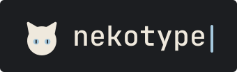

<p align="center">
  
</p>

# Nekotype (ねこタイプ)

> A lightweight, keyboard-first web app for learning Hiragana and Katakana from zero, with adaptive unlocking and progress tracking, and for typing Japanese words and phrases in romaji with instantaneous feedback, dual-tier romaji matching and zero latency.

**Status.** The code implements phases P0–P4 of the MVP specified in [docs/spec/](docs/spec/README.md), which is learning-first ([ADR 058](docs/adr/058-learning-first.md)): `/` teaches hiragana and katakana one kana at a time with introductions, recall, recognition and spaced reviews, with progress in IndexedDB, and typing Words and Phrases lives on `/type`: 1,275 N5–N4 words and 500 phrases generated from JMdict and Tatoeba, with saved results, personal bests and a local history on `/stats`. There is no backend yet (sync is P5, kana audio P6).

[](LICENSE)
[](https://www.typescriptlang.org/)
[](https://feature-sliced.design/)
[](#-performance-budgets)

---

## ✨ Features

- **🌱 Learning on `/`:** two tracks (hiragana, katakana); kana unlock one at a time when the answers to the unlocked ones are confident (10 answers, median at or under the target time, accuracy ≥ 90%); a session is 25 tasks (introduction, recall by typing, recognition among 4 options); spaced reviews in boxes 0–5; a kana chart, a streak and a daily answer-time chart on `/stats`. Learning and typing keep separate data.
- **⚡ Zero-Latency Typing:** Driven by an immutable Non-deterministic Finite Automaton (NFA) engine and fine-grained Preact signals. Keystrokes update without component tree re-renders.
- **🎯 Two-Tier Romaji Matching:**
  - **Strict IME Mode:** Strictly enforces official Microsoft IME / Google Japanese Input romaji keystrokes (e.g. `ti` → ち, `thi` → ティ, `who` → ウォ, `wo` → を).
  - **Learner Mode:** Accommodates intuitive learner habits (Hepburn, Kunrei, Nihon-shiki, vowel lengthening like `koohii`, and reading hints like `wa` for particle は in こんにちは).
- **🔤 Comprehensive Kana Coverage:**
  - 31 complete row sets across **Gojūon** (Basic), **Dakuten & Handakuten**, **Yōon** (Digraphs), and **Extended Katakana** (`ext_fa`, `ext_va`, `ext_wi`, `ext_ti`, `ext_che`).
  - Words and Phrases modes: N5–N4 words (JMdict, the JLPT lists) and short phrases (Tatoeba) with an English translation and a `source` link to the sentence. The content is generated by a pipeline from pinned sources; `/about` lists the sources, their licences and the authors of every phrase.
- **🧠 Adaptive Weak-Kana Weighting:**
  - Bayesian-inspired weakness formula: $\text{weakness} = \frac{m + 1}{a + 2}$.
  - Dynamically weights prompts during practice so your most frequent mistakes surface more often. For words and phrases the weight is the mean of the weights of their kana.
- **📊 Results screen:**
  - KPM with the difference to the average of the last 10 tests of the same mode and to the personal best, kana accuracy and time.
  - A personal best gets a badge and the content cat.
  - Up to five mistyped kana with their accepted spellings.
  - `repeat` replays the prompts of the finished test; a repeat is marked and gives no personal best.
  - A time or count test ends after 5 seconds without input or when the tab is hidden.
- **🗃️ Typing statistics on `/stats`:** personal bests per mode, KPM per test over the last 100 tests, and the history of saved tests in pages of 10, all from IndexedDB.
- **⌨️ Keyboard-First Ergonomics:**
  - Hidden input sink auto-focuses on mount and upon clicking the arena.
  - Typing any letter while a button has focus immediately refocuses and processes the key (Plan 6.2).
  - Zen: a test with no length, ended by the Finish button or Ctrl/Cmd+Enter; it is kept when a prompt is completed and time has passed, and dropped like a restart otherwise (ADR 042).
  - A text stream of three lines (two on a phone) with a caret and a romaji buffer at it; the interface fades out while a test runs and a wrong key flashes the caret (ADR 041).
  - Hybrid input: `keydown` on a desktop, `beforeinput` and an `input` fallback for mobile keyboards (Gboard composition), so a phone types too (ADR 038).
  - A non-Latin layout is not translated by the physical key: typing a Cyrillic letter shows "Switch your keyboard layout to English" and counts no mistake.
  - "Turn off the Japanese IME" appears only when the composition holds kana or kanji; Latin composition does not trigger it.
- **🎨 Design System:** Muted dark palette with a single eye-blue accent, Golos Text / JetBrains Mono / Noto Sans JP, a cat logo and favicon. Tokens live in `apps/web/src/shared/styles/tokens.css` and are checked against [`docs/design/source/tokens.json`](docs/design/source/tokens.json) (ADR 031, ADR 034).
- **🌐 Localization:** Instant bilingual toggle between English and Russian (`en` / `ru`).
- **♿ Accessible:**
  - Native `<dialog>` modal backdrops with automatic focus restoration to opener elements.
  - Polite live regions (`aria-live="polite"`) announcing test results to screen readers.
  - Radio group semantics on segmented selectors.
  - Respects `prefers-reduced-motion` operating system settings.

---

## 🗂️ Repository Layout

A pnpm workspace ([ADR 027](docs/adr/027-pnpm-workspace-layout-for-the-monorepo.md)); packages are consumed as TypeScript source, with no build step.

| Path                | Package             | Contents                                                                                                                                   |
| ------------------- | ------------------- | ------------------------------------------------------------------------------------------------------------------------------------------ |
| `apps/web/`         | `@nekotype/web`     | The Preact single-page app (Feature-Sliced Design), its tests, e2e tests, scripts, assets                                                  |
| `packages/engine/`  | `@nekotype/engine`  | The NFA romaji engine and the kana tables; imports nothing, runs in a browser or a Worker                                                  |
| `packages/shared/`  | `@nekotype/shared`  | Types (`Clock`, `Rng`, `Scheduler`, …) and runtime type guards shared with a future server                                                 |
| `packages/content/` | `@nekotype/content` | The content pipeline (build tool, never bundled): pinned sources, parsers, the word and phrase steps; `generate` writes the content chunks |

Root scripts run the package scripts with `pnpm -r`; run one package directly with `pnpm --filter @nekotype/web run <script>`.

### Content pipeline

Words and phrases are generated, never edited by hand. The input files are pinned in `packages/content/sources.json` and mirrored as assets of a GitHub release ([ADR 068](docs/adr/068-content-sources-mirrored-as-release-assets.md)). `pnpm --filter @nekotype/content run fetch` downloads them into `packages/content/.cache/` and checks the sha256; it needs the system `bzip2`. `pnpm --filter @nekotype/content run generate` builds the chunks into `apps/web/src/entities/prompt/content/` and the reports (`build-report.json`, `ru-coverage.json`, `audit-sample.md`) into the package; it is run by hand, never in CI, and its output is committed. Details are in [packages/content/README.md](packages/content/README.md) and [docs/spec/content.md](docs/spec/content.md).

---

## 🚀 Getting Started

### Prerequisites

- **Node.js**: `v24` or higher
- **pnpm**: `v10` or higher — the exact version is pinned in `packageManager` (`corepack enable` picks it up)

### Installation

```bash
git clone https://github.com/amp-r3/nekotype.git
cd nekotype
pnpm install
```

### Development Server

Start the local development server with Vite:

```bash
pnpm run dev
```

Open your browser to `http://localhost:5173`.

### Automated Verification Suite

Run the full verification pipeline (typecheck, ESLint + Steiger FSD lint, Prettier check, Vitest tests with the engine coverage threshold, production build, size budgets, Playwright e2e):

```bash
pnpm run verify         # what CI runs on a pull request
pnpm run verify:quick   # the same without e2e (what the pre-push hook runs)
```

To run individual verification gates:

```bash
pnpm run typecheck    # tsc --noEmit (zero any, zero as T, zero !)
pnpm run lint         # eslint in every package, plus steiger ./src in apps/web
pnpm run format:check # prettier --check .
pnpm test             # vitest run in every package (engine with a coverage threshold)
pnpm run build        # vite production build into apps/web/dist
pnpm run budget       # check-budget.mjs (size budgets from the Vite manifest)
pnpm run e2e          # Playwright on the production bundle (Chromium; WebKit in mobile emulation runs the @mobile tests)
pnpm run e2e:latency  # the keystroke latency test (about 2 min); CI runs it on main, by hand and on pull requests that touch input or loading code (ADR 074)
```

Fonts are subset by hand, not in CI: `pnpm --filter @nekotype/web run fonts` downloads the pinned sources into `apps/web/scripts/font-src/` (ignored by git), checks their SHA-256 and rewrites `glyphs.txt` and the `woff2` files in `apps/web/src/assets/fonts/` (ADR 034).

### End-to-End Testing (Playwright)

End-to-end browser integration tests are powered by Playwright and run as the last step of `pnpm run verify` in CI. CI runs in the `mcr.microsoft.com/playwright` image, so it installs no browser (ADR 054); the install below is for your own machine. The pre-push hook does not run them (`verify:quick`); run `pnpm run e2e` yourself when a change touches browser behaviour. The keystroke latency test is separate (`pnpm run e2e:latency`) and runs in CI on `main`, by hand and on pull requests that change a file which can move keystroke latency (ADR 052, 074). Its budgets are measured at 4× CPU throttling of the machine it runs on, so a run on a slower or busy developer machine can fail the worst-keystroke ceilings while CI passes with room to spare; the CI run is the gate (`docs/spec/quality.md`). They need Chromium and WebKit once; WebKit also needs its system libraries (`--with-deps`, which asks for `sudo` on Linux). Without them set `E2E_SKIP_WEBKIT=1` to run Chromium only (CI always runs both).

To install the browser binary and run the E2E suite:

```bash
pnpm --filter @nekotype/web exec playwright install --with-deps chromium webkit    # One-time install of the browsers
pnpm run e2e                        # Run the Playwright suite against the production bundle (vite build + vite preview)
```

### Git Hooks

`pnpm install --frozen-lockfile` runs the `prepare` script, which points Git at the versioned hooks in `.githooks/`. No extra dependencies are involved.

| Hook         | Runs                                                                                                               | Notes                                                                                                                                                                                                                                                                                    |
| ------------ | ------------------------------------------------------------------------------------------------------------------ | ---------------------------------------------------------------------------------------------------------------------------------------------------------------------------------------------------------------------------------------------------------------------------------------- |
| `pre-commit` | Line limit for `AGENTS.md`/`CLAUDE.md` (250), `prettier --check` on staged files, then `typecheck`, `lint`, `test` | Code checks are skipped when only Markdown files are staged                                                                                                                                                                                                                              |
| `pre-push`   | `pnpm run verify:quick` (no e2e); `prettier --check` only if the push changes only `.md` files                     | The e2e are not part of it: `pnpm run e2e` runs them against their own production build served on port 5273 (`E2E_PORT`), never a dev server you keep running; they need `pnpm --filter @nekotype/web exec playwright install --with-deps chromium webkit` once (or `E2E_SKIP_WEBKIT=1`) |

CI runs `verify` (with e2e) on every push and pull request; the hooks catch the same failures, except the browser ones, earlier. In an emergency, `git commit --no-verify` / `git push --no-verify` skips them.

---

## 📦 Performance Budgets

Nekotype adheres to strict first-load asset caps, checked by `pnpm run budget` (part of `verify`) from the Vite manifest. Figures of the current build:

| Asset                      | Budget Limit | Actual (gzip / woff2)  | Status                    |
| -------------------------- | ------------ | ---------------------- | ------------------------- |
| **Initial HTML**           | $\le 5$ KB   | **0.42 KB**            | ✅ Passed                 |
| **Initial JavaScript**     | $\le 35$ KB  | **29.51 KB**           | ✅ Passed                 |
| **Initial CSS**            | $\le 10$ KB  | **8.48 KB**            | ✅ Passed                 |
| **Noto Sans JP 400**       | $\le 45$ KB  | **20.38 KB** (woff2)   | ✅ Passed                 |
| **JetBrains Mono 400/500** | $\le 45$ KB  | **10.79 / 10.61 KB**   | ✅ Passed                 |
| **Golos Text 400/500**     | $\le 45$ KB  | **9.42 / 9.56 KB**     | ✅ Passed                 |
| **Total First Load**       | $\le 160$ KB | **99.17 KB**           | ✅ Passed (62% of budget) |
| **Lazy content chunk**     | $\le 40$ KB  | **24.15 KB** (largest) | ✅ Passed                 |
| **Lazy route chunk**       | $\le 25$ KB  | **11.81 KB** (largest) | ✅ Passed                 |

---

## ☁️ Deployment

Nekotype is a fully static SPA (`apps/web/dist/`, no backend; settings, learning and typing progress in IndexedDB, the language in `localStorage`) and ships to **Cloudflare Pages** at the domain root, so `VITE_BASE` stays at its default `/`.

**Production:** <https://nekotype.pages.dev> · **Previews:** one URL per pull request.

### CI/CD Pipeline

`.github/workflows/deploy.yml` runs on every push to `main` and on every pull request, in the Playwright image `mcr.microsoft.com/playwright:v<version>-noble` (its tag is the version of `@playwright/test` in the lockfile, which a unit test checks) with a 15-minute limit (ADR 054):

1. `pnpm install --frozen-lockfile` → `pnpm run verify` (typecheck + lint + Prettier + unit tests with coverage + build + size budget + e2e on Chromium, and the `@mobile` ones on WebKit). Any failure blocks the deploy. On `main` and on a manual run, `pnpm run e2e:latency` follows (ADR 052); a pull request runs it when it changes a file on the list in `apps/web/scripts/latency-gate.mjs` (ADR 074).
2. `wrangler pages deploy apps/web/dist` — PRs get a preview deployment; a push to `main` is deployed first to the preview branch `release-candidate`. Fork PRs verify but never deploy, since they cannot read secrets.
3. `scripts/smoke-deploy.mjs` requests the deployment that was just made (the address wrangler writes to `WRANGLER_OUTPUT_FILE_PATH`, else the branch alias): every route and its trailing-slash form must answer `200` with the application, a missing `/assets/*` file and an unknown path must answer `404` and not the application, and the bundle named by the entry page must load. These are behaviours of Cloudflare Pages that the dev server and the unit tests cannot show (ADR 039). Run it by hand against any address: `pnpm --filter @nekotype/web exec tsx scripts/smoke-deploy.mjs https://nekotype.pages.dev`.
4. On `main` only, after the candidate passes: the same build is deployed to production and the smoke test runs against production again. A failed candidate stops the workflow before production (ADR 045).

### One-Time Setup

1. Create the Pages project (the workflow also does this automatically on first run):
   ```bash
   pnpm dlx wrangler pages project create nekotype --production-branch=main
   ```
   Check that the project got exactly `nekotype.pages.dev` (no random suffix): `pnpm dlx wrangler pages project list`.
2. Copy **Account ID** from the Cloudflare dashboard → _Workers & Pages_ → _Overview_.
3. Create an API token with the **Cloudflare Pages — Edit** permission (_My Profile_ → _API Tokens_).
4. Add repository secrets under _Settings_ → _Secrets and variables_ → _Actions_:
   - `CLOUDFLARE_API_TOKEN`
   - `CLOUDFLARE_ACCOUNT_ID`
5. Push to `main` (or run the _Deploy_ workflow manually via `workflow_dispatch`).

A custom domain can be attached later in _Workers & Pages_ → _nekotype_ → _Custom domains_; no rebuild or code change is required.

### Manual Deploy

```bash
pnpm run verify                     # guarantees a passing build + budget
pnpm dlx wrangler pages deploy apps/web/dist --project-name nekotype --branch=main
```

### Caching & Headers

`apps/web/public/_headers` is copied into `apps/web/dist/` verbatim and served by Cloudflare Pages:

| Path          | Policy                                                                                                  | Why                                                                |
| ------------- | ------------------------------------------------------------------------------------------------------- | ------------------------------------------------------------------ |
| `/assets/*`   | `max-age=31536000, immutable`                                                                           | Vite emits content-hashed filenames, so a URL's bytes never change |
| `/index.html` | `max-age=0, must-revalidate`                                                                            | New deploys must be picked up immediately                          |
| `/*`          | `nosniff`, `strict-origin-when-cross-origin`, `X-Frame-Options: DENY`, restrictive `Permissions-Policy` | Baseline hardening                                                 |

`public/_redirects` rewrites each client-side route (`/type`, `/stats`, `/settings`, `/about`) to `/` with status `200` (a rewrite to `/index.html` would be answered with Pages' own 308 redirect to `/`, ADR 039); it deliberately has no catch-all (a test keeps it equal to the route list in `src/app/route-paths.ts`). A `404.html` is needed too: without it Cloudflare Pages answers every unknown path — including `/assets/typo.js` — with `index.html` and a `200`, which then gets cached as `immutable` under `/assets/*`. `apps/web/public/404.html` is a self-contained page (no extra requests) that turns misses into real `404`s.

---

## 🏛️ Architecture & Documentation

- **[docs/README.md](docs/README.md):** Documentation index — where to find each topic.
- **[docs/spec/](docs/spec/README.md):** MVP specification, one file per area. Normative.
- **[docs/adr/](docs/adr/README.md):** Architecture decision records, one file per decision.
- **[docs/architecture/baseline-v1.md](docs/architecture/baseline-v1.md):** Architecture of the current v1 code: layers, import boundaries, the NFA romaji engine, two-tier spelling tables, extension recipes.
- **[AGENTS.md](AGENTS.md):** Rules for AI coding agents (`CLAUDE.md` is a symlink to it).

---

## 📄 License

Nekotype is licensed in three parts; [NOTICE.md](NOTICE.md) maps every file to its terms.

- **Source code:** [GNU AGPL v3.0 only](LICENSE) (`AGPL-3.0-only`), with additional terms under section 7 (attribution, marking of modified versions, no trademark rights). If you run a modified version for users over a network, you must offer them its complete source code under the same licence.
- **Brand and mascot:** the name "Nekotype", the logos, favicon, banners and the cat (including its geometry in code) are © amp-r3, all rights reserved, and not covered by the AGPL. Forks and other public versions must replace them: see [BRAND.md](BRAND.md).
- **Fonts:** [SIL Open Font License 1.1](https://openfontlicense.org) (`OFL-1.1`):
  - Noto Sans JP: [OFL-NotoSansJP.txt](apps/web/src/assets/fonts/OFL-NotoSansJP.txt)
  - JetBrains Mono: [OFL-JetBrainsMono.txt](apps/web/src/assets/fonts/OFL-JetBrainsMono.txt)
  - Golos Text: [OFL-GolosText.txt](apps/web/src/assets/fonts/OFL-GolosText.txt)
